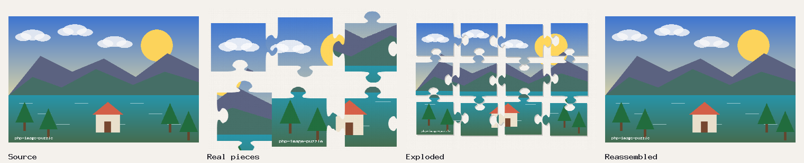

# PHP Image Puzzle

[](https://github.com/offline-agency/php-image-puzzle/actions/workflows/ci.yml)
[](https://codecov.io/gh/offline-agency/php-image-puzzle)
[](https://packagist.org/packages/offline-agency/image-puzzle)
[](https://packagist.org/packages/offline-agency/image-puzzle)
[](https://www.php.net/)
[](LICENSE)


Turn an image into a playable puzzle on the server with PHP and GD: real
interlocking jigsaw pieces (rectangular, hexagonal or triangular), sliding,
swap, rotation and strip puzzles, memory, tangram and nonogram. The library
writes the image assets and a versioned, reproducible game definition; one
shared rules engine plays it in the browser (plain JavaScript, Web Component,
React, Vue, Livewire or Filament) and validates saved games on the server.



**Requirements:** PHP 8.4 or 8.5 with ext-gd. Optional: ext-pcntl (parallel
work in the CLI), ext-zip (offline bundles), ext-exif (EXIF orientation).

## Install

```bash
composer require offline-agency/image-puzzle
```

## Quickstart

Build a playable jigsaw from a photo:

<!-- snippet -->
```php
use ImagePuzzle\Game\DefinitionBuilder;
use ImagePuzzle\Game\GameKind;

$result = (new DefinitionBuilder())->build('photo.jpg', 'public/puzzles/photo', GameKind::Jigsaw, 'easy', seed: 42);

echo $result->definitionPath(), "\n"; // public/puzzles/photo/definition.json
```

Or from the command line:

<!-- snippet -->
```bash
vendor/bin/image-puzzle generate photo.jpg public/puzzles/swap --kind=swap --preset=medium
vendor/bin/image-puzzle bundle public/puzzles/swap puzzle.zip   # plays offline, also from file://
```

Play it in a page. The player script ships with the Composer package, so no
npm build is needed:

```bash
cp vendor/offline-agency/image-puzzle/resources/dist/image-puzzle-player.iife.js public/
```

```html
<script src="/image-puzzle-player.iife.js"></script>
<image-puzzle-player src="/puzzles/photo/definition.json" persist></image-puzzle-player>
```

Pieces can be dragged, tapped or moved with the keyboard; progress is saved in
the browser with `persist`. See the [tutorial](docs/TUTORIAL.md) for the whole
flow, including server-side validation of saved games.

## Game modes

| Mode | Kind | Generated from the image |
| --- | --- | --- |
| Jigsaw | `jigsaw` | Interlocking pieces with shared, complementary edges; rectangular, hexagonal or triangular grids |
| Sliding | `sliding` | Classic 15-puzzle style board with one gap, always solvable |
| Swap | `swap` | Tiles swapped two at a time |
| Rotation | `rotation` | Tiles rotated in place |
| Strips | `strips` | Vertical strips reordered |
| Memory | `memory` | Pairs of picture cards, optionally with text labels |
| Tangram | `tangram` | The seven tangram pieces cut from a square crop, with known-solvable targets |
| Nonogram | `nonogram` | Clues computed from the image pixels, with a bounded uniqueness check |

Each mode has versioned `easy`, `medium` and `hard` presets plus validated
custom parameters. Rules, actions and state are specified in
[docs/GAME_MODES.md](docs/GAME_MODES.md).

## Packages in this repository

| Package | Location | Install |
| --- | --- | --- |
| `offline-agency/image-puzzle` (PHP core and CLI) | `/` | Packagist |
| `offline-agency/image-puzzle-livewire` | `integrations/livewire` | Not on Packagist yet: [install from the repository](docs/LIVEWIRE.md#distribution) |
| `offline-agency/image-puzzle-filament` | `integrations/filament` | Not on Packagist yet: [install from the repository](docs/FILAMENT.md) |
| `@offline-agency/image-puzzle-engine`, `-player`, `-react`, `-vue` | `packages/*` | Not on npm yet; the player bundle ships in the PHP package (`resources/dist`) |

Publication state is tracked in the [release runbook](docs/release/RUNBOOK.md).

## Documentation

| Guide | Covers |
| --- | --- |
| [TUTORIAL.md](docs/TUTORIAL.md) | From an uploaded photo to a playable, saved puzzle |
| [GAME_MODES.md](docs/GAME_MODES.md) | Modes, presets, definitions, state documents, versions and legal actions |
| [CLI.md](docs/CLI.md) | Every `image-puzzle` command, option and exit code |
| [EXPORT.md](docs/EXPORT.md) | Image formats, resolution sets and atlases, SVG, printable PDF, ZIP bundles, manifest |
| [BATCH.md](docs/BATCH.md) | Batch builds, the asset cache, publishing to filesystems or S3-compatible storage, queues |
| [PLAYER_API.md](docs/PLAYER_API.md) | Engine, player, Web Component, configurator, React and Vue, styling and events |
| [LIVEWIRE.md](docs/LIVEWIRE.md) and [FILAMENT.md](docs/FILAMENT.md) | Laravel integrations |
| [CODEIGNITER.md](docs/CODEIGNITER.md) | A CodeIgniter 4 recipe with a tested example application |
| [OPERATIONS.md](docs/OPERATIONS.md) | Limits, errors, path trust, memory, worker callbacks and file ownership |
| [USAGE.md](docs/USAGE.md), [EDGE_STYLES.md](docs/EDGE_STYLES.md), [SPLIT_STRATEGY.md](docs/SPLIT_STRATEGY.md) | Splitting images into pieces with a manifest (the `PuzzleGenerator` API) |
| [MIGRATION.md](docs/MIGRATION.md) | Upgrading from 1.x |
| [WHY.md](docs/WHY.md) | When this library fits, compared with plain GD cropping and browser-only puzzles |
| [API.md](docs/API.md) | Compact API and recipe reference |
| [EXAMPLES.md](docs/EXAMPLES.md) | Every runnable example (PHP, JavaScript, Web Component, React, Vue, Laravel, CodeIgniter) and the test that runs it |

To show the library with your own picture, `php examples/demo/build.php
build/demo photo.jpg` writes a static site with one puzzle per mode
([examples/demo](examples/demo/README.md)).

## Contributing and security

See [CONTRIBUTING.md](CONTRIBUTING.md) for the development setup and checks,
and [AGENTS.md](AGENTS.md) for a condensed version aimed at coding agents.
Report vulnerabilities privately as described in [SECURITY.md](SECURITY.md).
Changes are listed in [CHANGELOG.md](CHANGELOG.md).

## Credits

Inspired by the archived [pear/Image_Puzzle](https://github.com/pear/Image_Puzzle);
this is an independent implementation.

- [Offline Agency](https://github.com/offline-agency)
- [Giacomo Fabbian](https://github.com/Giacomo92)
- [All contributors](https://github.com/offline-agency/php-image-puzzle/graphs/contributors)

Offline Agency is a web agency based in Padua, Italy: [offlineagency.it](https://offlineagency.it/).

## License

The MIT License (MIT). See [LICENSE](LICENSE).
